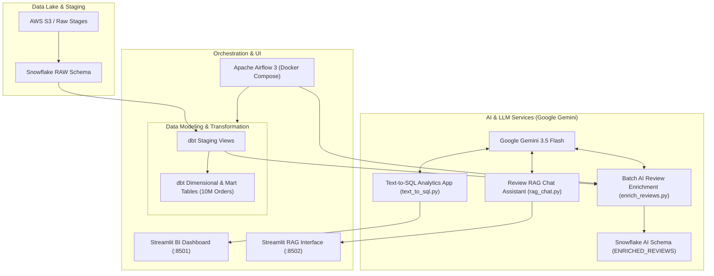

# 🍔 Zomato AI Data Analytics & Intelligence Platform

An enterprise-grade, end-to-end AI and Data Analytics platform built over **10 Million+ orders** and customer records on **Snowflake**. 

The platform integrates modern data engineering (**dbt**, **Apache Airflow**) with generative artificial intelligence (**Google Gemini** & **OpenAI**) to provide zero-shot natural language Text-to-SQL analytics and semantic Retrieval-Augmented Generation (RAG) review intelligence.

---

## 🏗️ Architecture Overview



---

## ✨ Key Features

1. **Natural Language Text-to-SQL Engine (`ai/text_to_sql.py`)**:
   - Ask complex business questions in English (e.g., *"Top 10 cities by GMV"*, *"Average delivery time by city, worst first"*).
   - Generates production-ready Snowflake SQL dynamically using **Google Gemini 3.5 Flash**.
   - Built-in SQL safety guardrails protecting against destructive operations (`DROP`, `DELETE`, `TRUNCATE`, etc.).
   - Live query execution on Snowflake over **10,000,000 orders** with interactive data tables and charts.

2. **Customer Review RAG Intelligence Assistant (`ai/rag_chat.py`)**:
   - Grounded Retrieval-Augmented Generation over customer reviews.
   - Dense TF-IDF semantic vector search with local caching.
   - Contextual synthesis summarizing complaints, operational highlights, delivery partner speeds, and city-specific sentiment patterns.

3. **Automated Review AI Enrichment Pipeline (`ai/enrich_reviews.py`)**:
   - Automated batch processing of customer feedback.
   - Extracts structured sentiment (Positive/Neutral/Negative), normalized sentiment scores (-1.0 to 1.0), primary aspects (Packaging, Delivery Time, Food Quality, Price), and complaint flags into `ZOMATO.AI.ENRICHED_REVIEWS`.

4. **Production Data Modeling (`Zomato/`)**:
   - Dimensional modeling with **dbt**:
     - Dimensions: `dim_customer`, `dim_restaurants`, `dim_food`, `dim_date`
     - Facts: `fct_orders` (10M rows), `fct_order_items`
     - Marts: `mart_daily_city_revenue`, `mart_restaurant_performance`, `mart_delive_sla`, `mart_review_sentiment`

5. **End-to-End Orchestration (`airflow/`)**:
   - Airflow 3 containerized DAG (`zomato_batch.py`) automating raw loading -> dbt core build -> AI enrichment -> dbt AI marts.

---

## 📂 Repository Structure

```text
├── ai/
│   ├── text_to_sql.py             # Streamlit Text-to-SQL application
│   ├── rag_chat.py                # Streamlit Review RAG Chat application
│   ├── enrich_reviews.py          # AI sentiment & aspect extraction pipeline
│   ├── .env.example               # Environment variables template for AI apps
│   └── review_embeddings.parquet  # Cached review embeddings
├── airflow/
│   ├── dags/
│   │   └── zomato_batch.py        # Airflow ELT + AI batch orchestration DAG
│   ├── docker-compose.yaml        # Local Airflow 3 multi-container stack
│   ├── Dockerfile                 # Airflow image with dbt & snowflake drivers
│   └── .env.example               # Airflow environment template
├── Zomato/                        # dbt transformation project
│   ├── models/
│   │   ├── staging/               # Raw staging views
│   │   └── marts/                 # Dimensional stars & business marts
│   ├── dbt_project.yml
│   └── profiles.yml
├── requirements.txt               # Python package dependencies
├── .gitignore                     # Git ignore rules (secrets & large datasets)
└── README.md                      # Project documentation
```

---

## 🚀 Getting Started

### 1. Prerequisites
- Python 3.10+
- Snowflake Account with `ACCOUNTADMIN` or `DBT_ROLE`
- Google Gemini API Key (or OpenAI API Key)
- Docker Desktop (optional, for running Airflow)

### 2. Installation

Clone the repository and install the Python dependencies:

```bash
git clone <your-repository-url>
cd "Zomato AI Data Analytics"

python -m venv .venv
source .venv/bin/activate    # On Windows: .venv\Scripts\activate
pip install -r requirements.txt
```

### 3. Environment Configuration

Copy the example environment files and enter your credentials:

```bash
cp ai/.env.example ai/.env
cp airflow/.env.example airflow/.env
```

Configure `ai/.env`:
```env
SNOWFLAKE_ACCOUNT=your-account-id
SNOWFLAKE_USER=your-username
SNOWFLAKE_PASSWORD=your-password
SNOWFLAKE_WAREHOUSE=ZOMATO_WH
SNOWFLAKE_DATABASE=ZOMATO
SNOWFLAKE_SCHEMA=MARTS
SNOWFLAKE_ROLE=ACCOUNTADMIN

GEMINI_API_KEY=your-gemini-api-key
GEMINI_MODEL=gemini-3.5-flash
```

---

## 🖥️ Running the Applications

### Launch the Text-to-SQL Analytics App
```bash
streamlit run ai/text_to_sql.py --server.port 8501
```
Open **[http://localhost:8501](http://localhost:8501)** in your browser.

### Launch the Review RAG Assistant
```bash
streamlit run ai/rag_chat.py --server.port 8502
```
Open **[http://localhost:8502](http://localhost:8502)** in your browser.

### Run Review AI Enrichment Manually
```bash
python ai/enrich_reviews.py
```

### Run dbt Transformations
```bash
cd Zomato
dbt run --profiles-dir .
dbt test --profiles-dir .
```

### Run Airflow Pipeline (Docker)
```bash
cd airflow
docker compose up -d
```
Access the Airflow UI at **[http://localhost:8080](http://localhost:8080)** (default credentials: `admin` / `admin`).

---

## 🔒 Security & Data Hygiene
- All `.env` and credential files are strictly ignored by `.gitignore`.
- Raw multi-gigabyte data files (`data-*/`) are excluded from version control.
- Hardcoded passwords and secret tokens have been sanitized.

---

## 📜 License
This project is open-source and available under the [MIT License](LICENSE).
